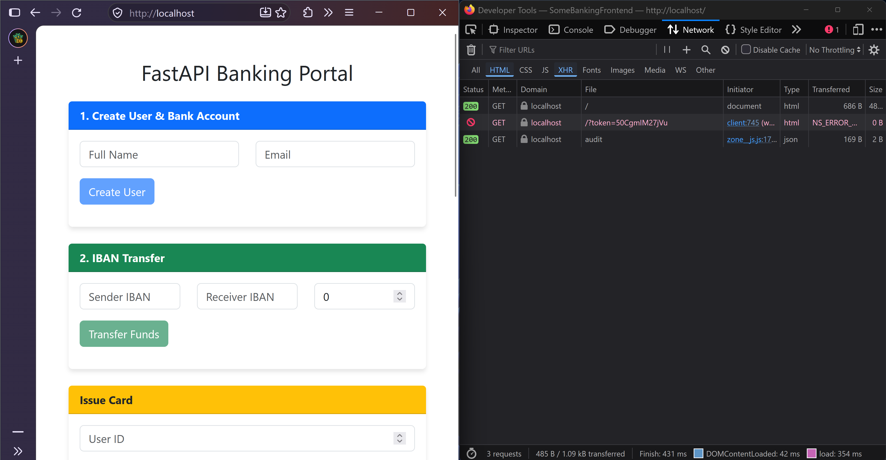

# SSS2026 - Strumenti di sviluppo software (CI/CD)

## Lab 1: Git
Commit, branching, push/pull, merge and merge-conflict practice (done on this README).

## Docker Esercitazione: docker-webserver/
Local deploy of a webserver with Docker: own nginx (nginx:alpine) image serving an HTML page.

## Esercitazione 2: somebankingapp-dockerfiles/
Dockerfiles for the SomeBankingApp backend (FastAPI) and frontend (Angular).

## Esercitazione 3: somebankingapp-dockerfiles/

1. Updated the backend and frontend Dockerfiles to clone the app from its original GitHub repository instead of copying local files.
2. Wrote a proxy (nginx) that sends `/` to the frontend and `/api/` to the backend, on port 80.
3. Tagged the three images (`banking-backend:1.0`, `banking-frontend:1.0`, `banking-proxy:1.0`).
4. Wrote a `docker-compose.yaml` that runs all three on one network, with only the proxy reachable from outside.

### Problems I noticed and fixed
- The frontend had the backend address (`http://127.0.0.1:8000`) written in its code, so it skipped the proxy. Replaced it with `/api` in the frontend Dockerfile.
- DevTools showed the live-reload connection failing through the proxy (the app itself worked). Fixed it by forwarding the WebSocket headers in nginx, with the help of Claude Opus 5.5.

Before :

After :

Fix: [a22001d](https://github.com/ilyes-ship-it/SSS2026/commit/a22001d)

## Esercitazione 4: Jenkins (somebankingapp-dockerfiles/jenkins/)

1. Installed Jenkins LTS with Docker plus a Docker-in-Docker container, so Jenkins can build images.
2. Built a custom Jenkins image (`banking-jenkins:1.0`) with the Docker CLI and the docker-workflow plugin.
3. Created a freestyle job running `docker version` to test the connection to dind.
4. Wrote a `jenkinsfile` that clones the repo and builds the backend and frontend images.
5. Created a Pipeline job that reads the jenkinsfile from the repo. Tested it on the feature branch, then on `main`.